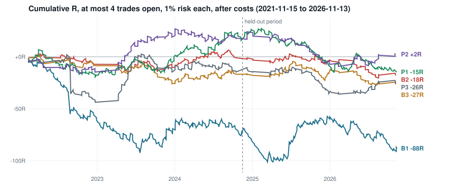

# 5-year test of the swing rules on NSE

Data **2021-11-15 to 2026-11-13**, 2,104 NSE equities with enough history, liquidity at least ₹10 crore a day at the time of each signal. Nifty 50 over the period: **+38.8%** (Nov 2021 – Nov 2024: +29.9%, Nov 2024 – Nov 2026: +7.2%).

**R** is profit or loss divided by the amount risked on the trade. +0.10R a trade means risking ₹1,000 a trade earned ₹100 on average. Costs of 0.3% a round trip are included unless a column says otherwise.

## Verdict

- **No tested rule set made money after costs over the 5 years.** The best, P2, averaged -0.065R a trade.
- **Held-out period (Nov 2024 – Nov 2026): every variant lost money.**
- **Breakouts lost in every single year**, including the strong market of 2023. The original tight-stop version (B1) is clearly negative (t = -11.72).
- **Pullbacks worked in 2022–2023 and stopped working from 2024.** Before costs they were slightly positive (+0.050R); costs turn that into a loss.
- **Do not trade these rules with real money.** Keep the daily runs as paper trades and treat every card as untested.

## Results

| Code | Rules | Trades | Win % | Avg R after costs | Before costs | t-stat | Nov 21–Nov 24 | Nov 24–Nov 26 | 4-at-a-time total | Worst drawdown |
| --- | --- | ---: | ---: | ---: | ---: | ---: | ---: | ---: | ---: | ---: |
| **B1** | Breakout as written: retest entry, stop 0.25 ATR under the level | 6,462 | 22.7 | **-0.306** | -0.107 | -11.72 | -0.274 | -0.349 | -88.2R | -101.1R |
| **B2** | Breakout, stop 1 ATR under the level, stock above a rising 50-day, Nifty above its 50-day | 3,413 | 37.6 | **-0.103** | -0.030 | -4.68 | -0.065 | -0.179 | -18.0R | -27.0R |
| **B3** | B2 but buy the next open after the breakout (no retest wait) | 1,995 | 36.4 | **-0.123** | -0.047 | -4.11 | -0.062 | -0.245 | -26.5R | -29.2R |
| **P1** | Pullback to the 20-day average in an uptrend, higher low, limit entry in the zone | 16,885 | 35.7 | **-0.073** | +0.038 | -4.82 | +0.004 | -0.181 | -14.8R | -42.6R |
| **P2** | P1 + Nifty above its 50-day | 12,254 | 35.6 | **-0.065** | +0.050 | -3.39 | +0.023 | -0.220 | +2.3R | -36.2R |
| **P3** | P2 but buy the next open after the signal | 4,028 | 32.8 | **-0.153** | -0.047 | -6.33 | -0.086 | -0.279 | -25.8R | -45.6R |

A t-stat below −2 means the loss is very unlikely to be bad luck; between −2 and +2 means no clear edge either way.

### Average R per trade by year (after costs)

| Code | 2022 | 2023 | 2024 | 2025 | 2026 |
| --- | ---: | ---: | ---: | ---: | ---: |
| B1 | -0.36 (829) | -0.18 (1,552) | -0.33 (1,531) | -0.35 (1,347) | -0.34 (1,203) |
| B2 | -0.16 (408) | -0.03 (974) | -0.07 (936) | -0.14 (692) | -0.22 (403) |
| B3 | -0.08 (255) | -0.04 (551) | -0.10 (546) | -0.19 (416) | -0.30 (227) |
| P1 | +0.08 (2,011) | +0.17 (3,790) | -0.16 (4,306) | -0.22 (3,406) | -0.18 (3,372) |
| P2 | +0.16 (1,320) | +0.22 (2,894) | -0.19 (3,660) | -0.22 (2,732) | -0.22 (1,648) |
| P3 | -0.21 (425) | +0.08 (1,045) | -0.19 (1,159) | -0.28 (855) | -0.27 (544) |

(trades in brackets; 2022 starts in mid-February because each signal needs 60 days of history)

## Cumulative result, 1% risk a trade, at most 4 open



## How the test works

- **Signals** follow the trade-sentinel definitions: a BREAKOUT is a close above a level touched 2+ times in the prior 20 sessions on at least 1.5× average volume; a PULLBACK is a stock above a rising 50-day average that dips to its 20-day average, makes a higher low and closes up.
- **Plans** follow the PLAN engine and the swing rules: entry zone from the setup, structural stop, target the nearer of the prior swing high and entry + 3 ATR, reward:risk at least 2, entry zone within 1 ATR of the signal close.
- **Trades** enter within 3 sessions (or at the next open where stated) and exit at the stop, the target, or the close of the 10th session. When the stop and target are both inside one day's range the stop is assumed first.
- The rules were fixed before the results were seen, and the Nov 2024 – Nov 2026 period was not used to choose them.

## Limits

- Only stocks listed today are included, so companies that delisted or went bust are missing; real results would likely be a little worse.
- Yahoo daily prices, split-adjusted; no slippage beyond the cost estimate; circuit-locked days can make real stops fill worse.
- Claude's chart judgment (the SIGNAL score and the RISK second opinion) is not tested here. It has no track record yet; the daily runs' journal is the way to measure it.
- Results are per signal; the 4-at-a-time column shows one realistic way of taking them, not the only one.

## Re-run

```bash
python3 research/fetch_history.py          # ~4 min, 5 years for every NSE equity
python3 research/backtest.py               # ~20 s
python3 research/make_report.py            # this page
```

Data: [results/backtest-2026-11-13.json](results/backtest-2026-11-13.json).

_Educational, not investment advice._
