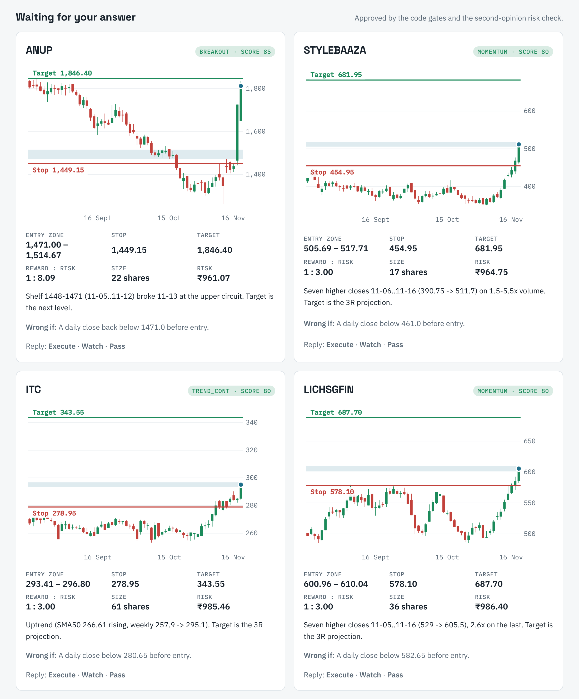
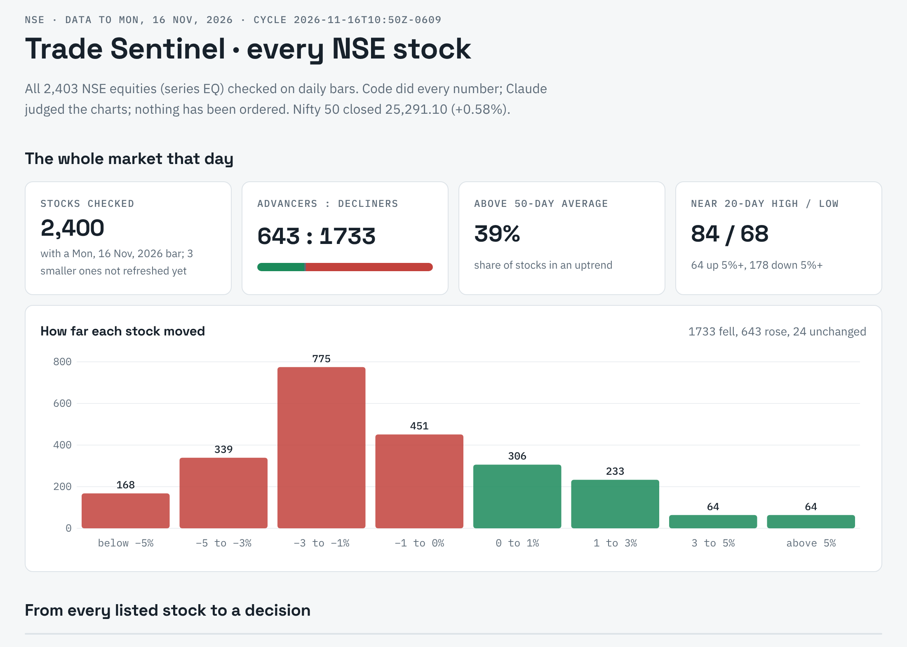
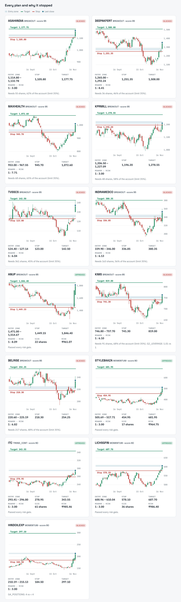
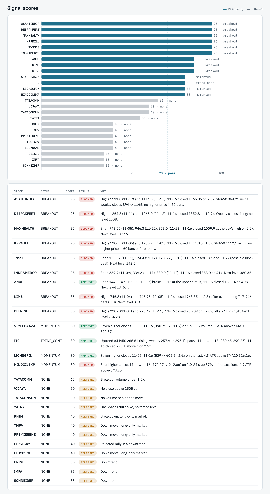

# Trade Sentinel · 2026-11-16

NSE data to **2026-11-16** · cycle `2026-11-16T10:50Z-0609` · Nifty 50 25,291.10 (0.58%)

**2,400 stocks checked** · 643 advanced, 1733 declined · 39% above their 50-day average · 84 near a 20-day high, 68 near a low

2,403 NSE equities → 974 liquid → 150 shortlisted → 25 scanned → 13 signals passed → 13 planned → **4 approved**

## Waiting for your answer

| Stock | Setup | Score | Entry zone | Stop | Target | R:R | Size | Risk |
| --- | --- | ---: | --- | ---: | ---: | ---: | ---: | ---: |
| **ANUP** | BREAKOUT | 85 | 1,471.00 – 1,514.67 | 1,449.15 | 1,846.40 | 8.09 | 22 | ₹961.07 |
| **STYLEBAAZA** | MOMENTUM | 80 | 505.69 – 517.71 | 454.95 | 681.95 | 3.0 | 17 | ₹964.75 |
| **ITC** | TREND_CONT | 80 | 293.41 – 296.80 | 278.95 | 343.55 | 3.0 | 61 | ₹985.46 |
| **LICHSGFIN** | MOMENTUM | 80 | 600.96 – 610.04 | 578.10 | 687.70 | 3.0 | 36 | ₹986.40 |

**Blocked:** ASAHIINDIA needs 55 shares, 62% of the account (limit 35%); DEEPAKFERT needs 36 shares, 46% of the account (limit 35%); MAXHEALTH needs 68 shares, 65% of the account (limit 35%); KPRMILL needs 48 shares, 58% of the account (limit 35%); TVSSCS needs 361 shares, 45% of the account (limit 35%); INDRAMEDCO needs 163 shares, 56% of the account (limit 35%); KIMS needs 91 shares, 68% of the account (limit 35%), G2_LEVERAGE 1.01 vs 1.0; BELRISE needs 217 shares, 48% of the account (limit 35%); HINDOILEXP G4_POSITIONS 4 vs < 4.

## Market and funnel

## Every plan

## Signal scores

Whole page as one image: [full.png](full.png). Data: [2026-11-16T1050Z-0609.json](2026-11-16T1050Z-0609.json).

_Educational, not investment advice. You place every order yourself._
