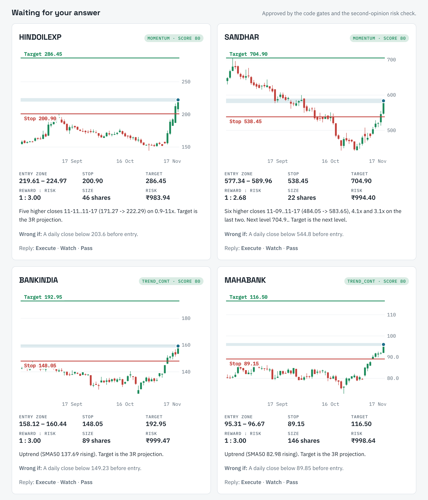
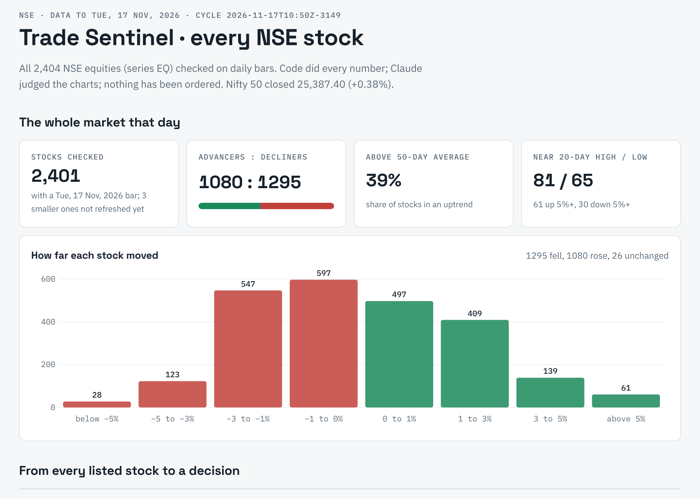
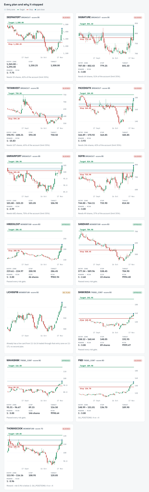
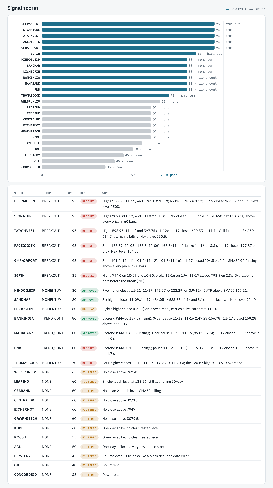

# Trade Sentinel · 2026-11-17

NSE data to **2026-11-17** · cycle `2026-11-17T10:50Z-3149` · Nifty 50 25,387.40 (0.38%)

**2,401 stocks checked** · 1080 advanced, 1295 declined · 39% above their 50-day average · 81 near a 20-day high, 65 near a low

2,404 NSE equities → 971 liquid → 150 shortlisted → 25 scanned → 13 signals passed → 12 planned → **4 approved**

## Waiting for your answer

| Stock | Setup | Score | Entry zone | Stop | Target | R:R | Size | Risk |
| --- | --- | ---: | --- | ---: | ---: | ---: | ---: | ---: |
| **HINDOILEXP** | MOMENTUM | 80 | 219.61 – 224.97 | 200.90 | 286.45 | 3.0 | 46 | ₹983.94 |
| **SANDHAR** | MOMENTUM | 80 | 577.34 – 589.96 | 538.45 | 704.90 | 2.68 | 22 | ₹994.40 |
| **BANKINDIA** | TREND_CONT | 80 | 158.12 – 160.44 | 148.05 | 192.95 | 3.0 | 89 | ₹999.47 |
| **MAHABANK** | TREND_CONT | 80 | 95.31 – 96.67 | 89.15 | 116.50 | 3.0 | 146 | ₹998.64 |

**Blocked:** DEEPAKFERT needs 33 shares, 42% of the account (limit 35%); SIGNATURE needs 64 shares, 51% of the account (limit 35%); TATAINVEST needs 107 shares, 65% of the account (limit 35%); PACEDIGITK needs 246 shares, 42% of the account (limit 35%); GMRAIRPORT needs 682 shares, 70% of the account (limit 35%); SGFIN needs 49 shares, 37% of the account (limit 35%); PNB G4_POSITIONS 4 vs < 4; THOMASCOOK G3_RR 0.96 vs 2.0, G4_POSITIONS 4 vs < 4.

## Market and funnel

## Every plan

## Signal scores

Whole page as one image: [full.png](full.png). Data: [2026-11-17T1050Z-3149.json](2026-11-17T1050Z-3149.json).

_Educational, not investment advice. You place every order yourself._
