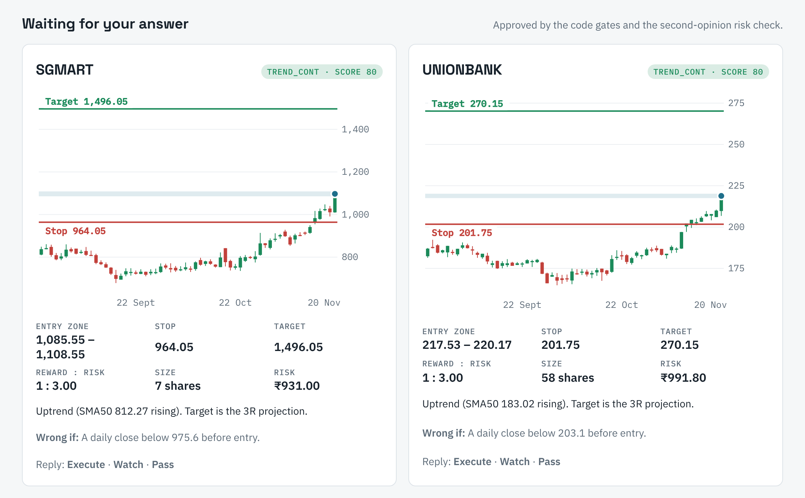
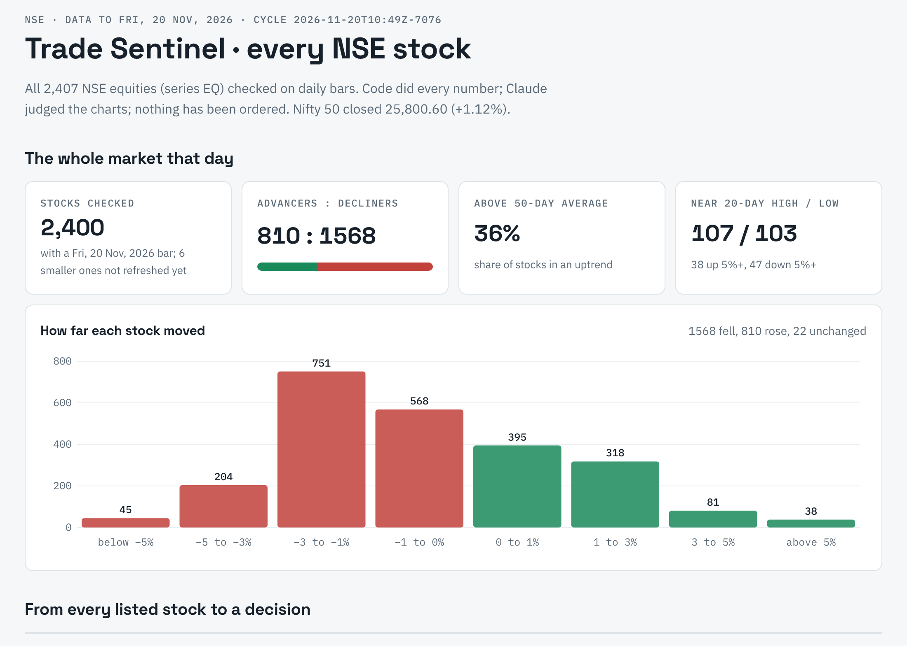
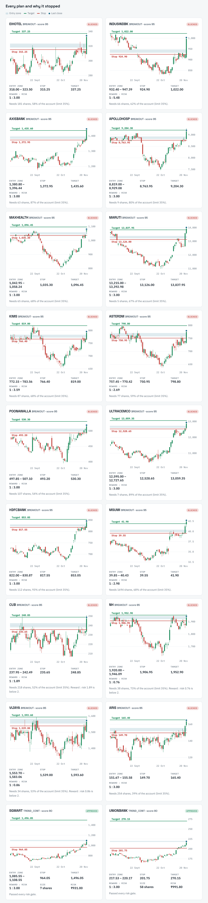
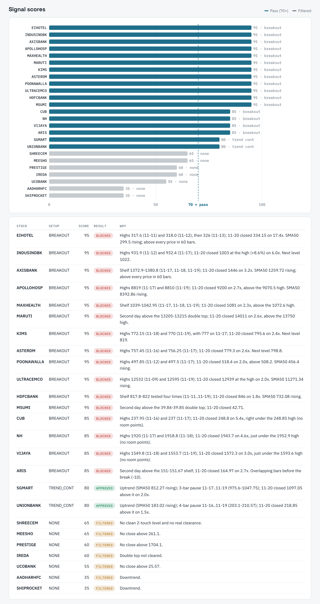

# Trade Sentinel · latest run (2026-11-20)

NSE data to **2026-11-20** · cycle `2026-11-20T10:49Z-7076` · Nifty 50 25,800.60 (1.12%)

**2,400 stocks checked** · 810 advanced, 1568 declined · 36% above their 50-day average · 107 near a 20-day high, 103 near a low

2,407 NSE equities → 968 liquid → 150 shortlisted → 25 scanned → 18 signals passed → 18 planned → **2 approved**

Older runs: open a dated folder above. How earlier cards turned out: [TRACKER.md](TRACKER.md).

## Waiting for your answer

| Stock | Setup | Score | Entry zone | Stop | Target | R:R | Size | Risk |
| --- | --- | ---: | --- | ---: | ---: | ---: | ---: | ---: |
| **SGMART** | TREND_CONT | 80 | 1,085.55 – 1,108.55 | 964.05 | 1,496.05 | 3.0 | 7 | ₹931.00 |
| **UNIONBANK** | TREND_CONT | 80 | 217.53 – 220.17 | 201.75 | 270.15 | 3.0 | 58 | ₹991.80 |

**Blocked:** EIHOTEL needs 181 shares, 58% of the account (limit 35%); INDUSINDBK needs 66 shares, 62% of the account (limit 35%); AXISBANK needs 63 shares, 87% of the account (limit 35%); APOLLOHOSP needs 9 shares, 80% of the account (limit 35%); MAXHEALTH needs 65 shares, 68% of the account (limit 35%); MARUTI needs 5 shares, 67% of the account (limit 35%); KIMS needs 87 shares, 68% of the account (limit 35%); ASTERDM needs 77 shares, 59% of the account (limit 35%); POONAWALLA needs 107 shares, 54% of the account (limit 35%); ULTRACEMCO needs 7 shares, 89% of the account (limit 35%); HDFCBANK needs 112 shares, 93% of the account (limit 35%); MSUMI needs 1694 shares, 68% of the account (limit 35%); CUB needs 218 shares, 52% of the account (limit 35%), G3_RR 1.89 vs 2.0; NH needs 38 shares, 73% of the account (limit 35%), G3_RR 0.76 vs 2.0; VIJAYA needs 34 shares, 53% of the account (limit 35%), G3_RR 0.86 vs 2.0; ARIS needs 254 shares, 39% of the account (limit 35%).

## Market and funnel

## Every plan

## Signal scores

Whole page as one image: [full.png](2026-11-20/full.png). Data: [2026-11-20T1049Z-7076.json](2026-11-20/2026-11-20T1049Z-7076.json).

_Educational, not investment advice. You place every order yourself._
