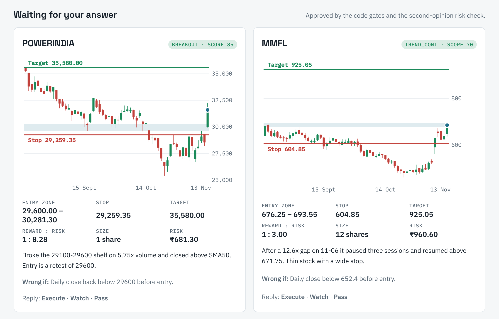
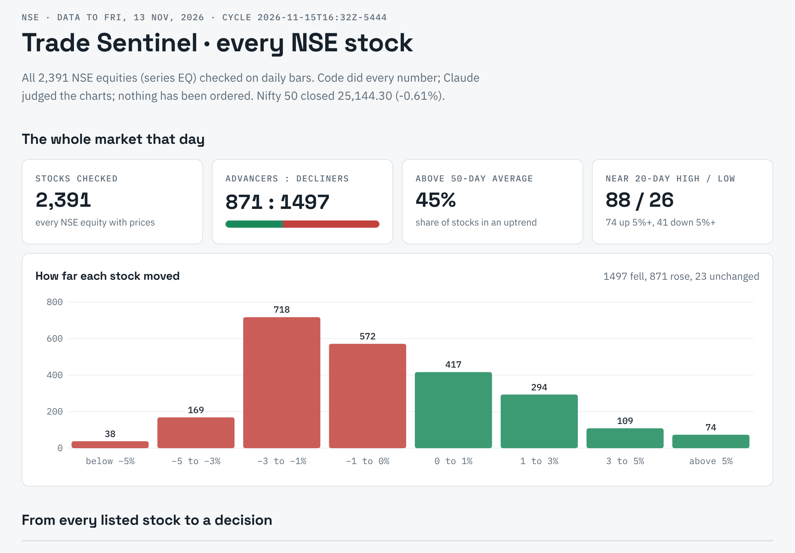
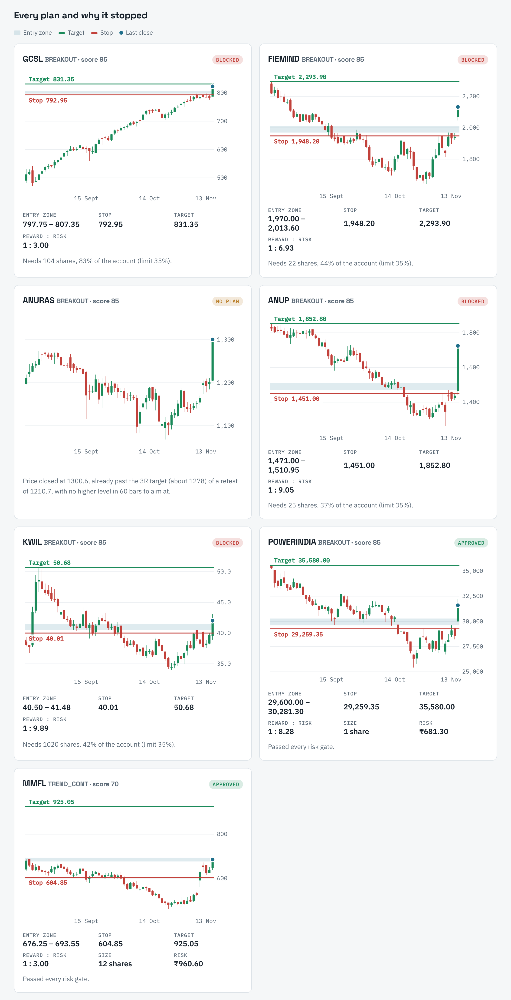
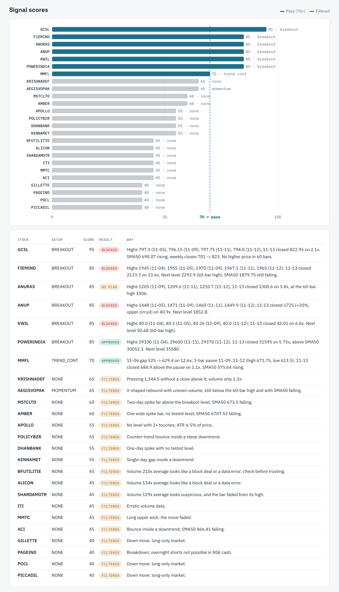

# Trade Sentinel · latest run (2026-11-13)

NSE data to **2026-11-13** · cycle `2026-11-15T16:32Z-5444` · Nifty 50 25,144.30 (-0.61%)

**2,391 stocks checked** · 871 advanced, 1497 declined · 45% above their 50-day average · 88 near a 20-day high, 26 near a low

2,391 NSE equities → 979 liquid → 150 shortlisted → 25 scanned → 7 signals passed → 6 planned → **2 approved**

Older runs: open a dated folder above.

## Waiting for your answer

| Stock | Setup | Score | Entry zone | Stop | Target | R:R | Size | Risk |
| --- | --- | ---: | --- | ---: | ---: | ---: | ---: | ---: |
| **POWERINDIA** | BREAKOUT | 85 | 29,600.00 – 30,281.30 | 29,259.35 | 35,580.00 | 8.28 | 1 | ₹681.30 |
| **MMFL** | TREND_CONT | 70 | 676.25 – 693.55 | 604.85 | 925.05 | 3.0 | 12 | ₹960.60 |

**Blocked:** GCSL needs 104 shares, 83% of the account (limit 35%); FIEMIND needs 22 shares, 44% of the account (limit 35%); ANUP needs 25 shares, 37% of the account (limit 35%); KWIL needs 1020 shares, 42% of the account (limit 35%).

## Market and funnel

## Every plan

## Signal scores

Whole page as one image: [full.png](2026-11-13/full.png). Data: [2026-11-15T1632Z-5444.json](2026-11-13/2026-11-15T1632Z-5444.json).

_Educational, not investment advice. You place every order yourself._
