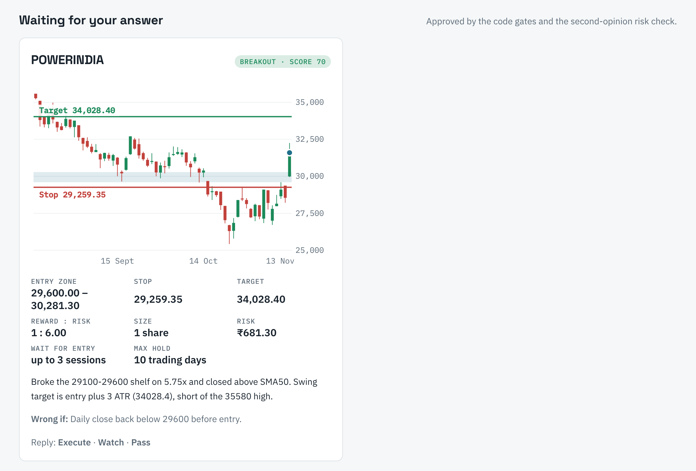
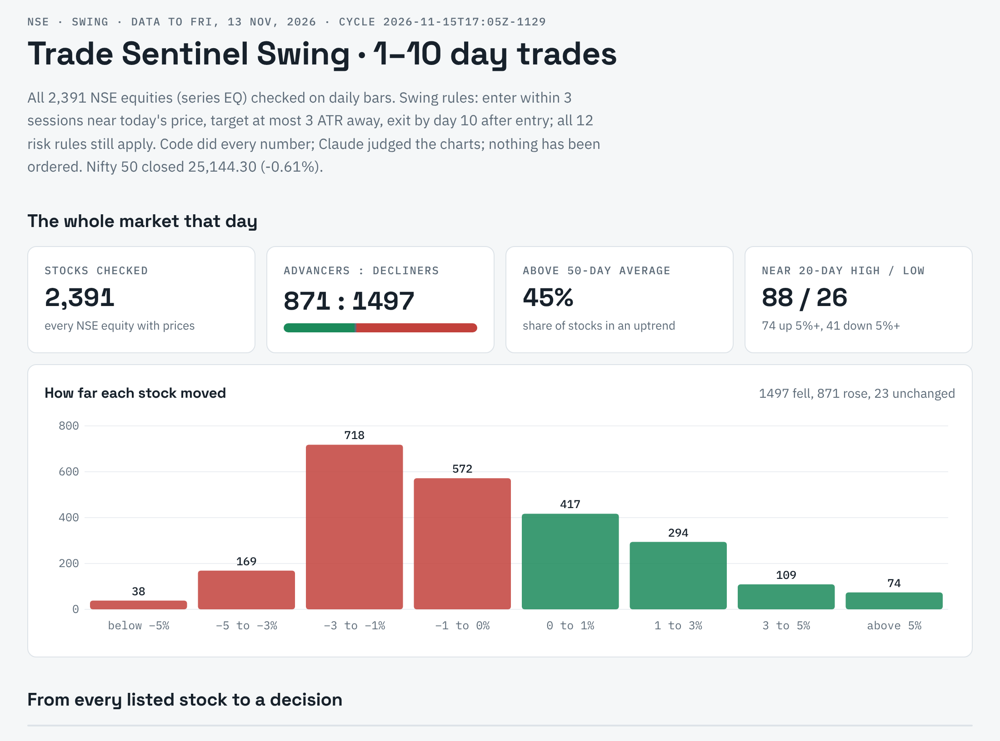
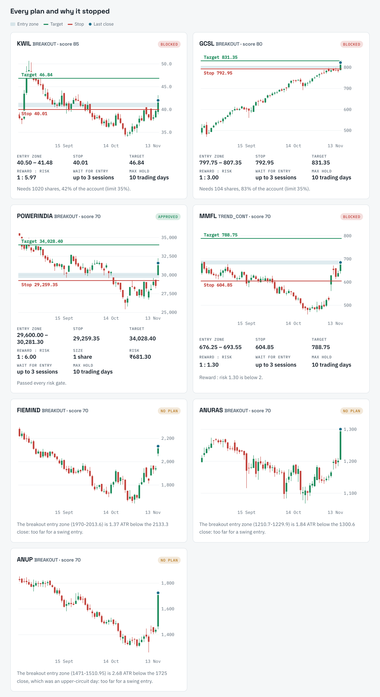
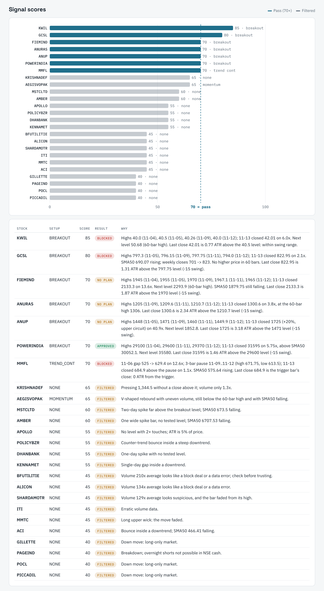

# Trade Sentinel Swing · 2026-11-13

NSE data to **2026-11-13** · cycle `2026-11-15T17:05Z-1129` · Nifty 50 25,144.30 (-0.61%)

**2,391 stocks checked** · 871 advanced, 1497 declined · 45% above their 50-day average · 88 near a 20-day high, 26 near a low

2,391 NSE equities → 979 liquid → 150 shortlisted → 25 scanned → 7 signals passed → 4 planned → **1 approved**

**Swing rules:** enter within 3 sessions, near today's price (within 1.0 ATR); target at most 3.0 ATR away; exit by the close of day 10 after entry if neither stop nor target hits. All 12 risk rules still apply.

## Waiting for your answer

| Stock | Setup | Score | Entry zone | Stop | Target | R:R | Size | Risk |
| --- | --- | ---: | --- | ---: | ---: | ---: | ---: | ---: |
| **POWERINDIA** | BREAKOUT | 70 | 29,600.00 – 30,281.30 | 29,259.35 | 34,028.40 | 6.0 | 1 | ₹681.30 |

**Blocked:** KWIL needs 1020 shares, 42% of the account (limit 35%); GCSL needs 104 shares, 83% of the account (limit 35%); MMFL G3_RR 1.3 vs 2.0.

## Market and funnel

## Every plan

## Signal scores

Whole page as one image: [full.png](full.png). Data: [2026-11-15T1705Z-1129.json](2026-11-15T1705Z-1129.json).

_Educational, not investment advice. You place every order yourself._
