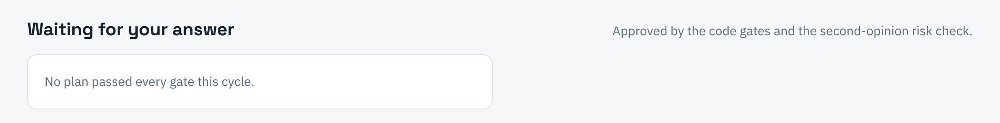
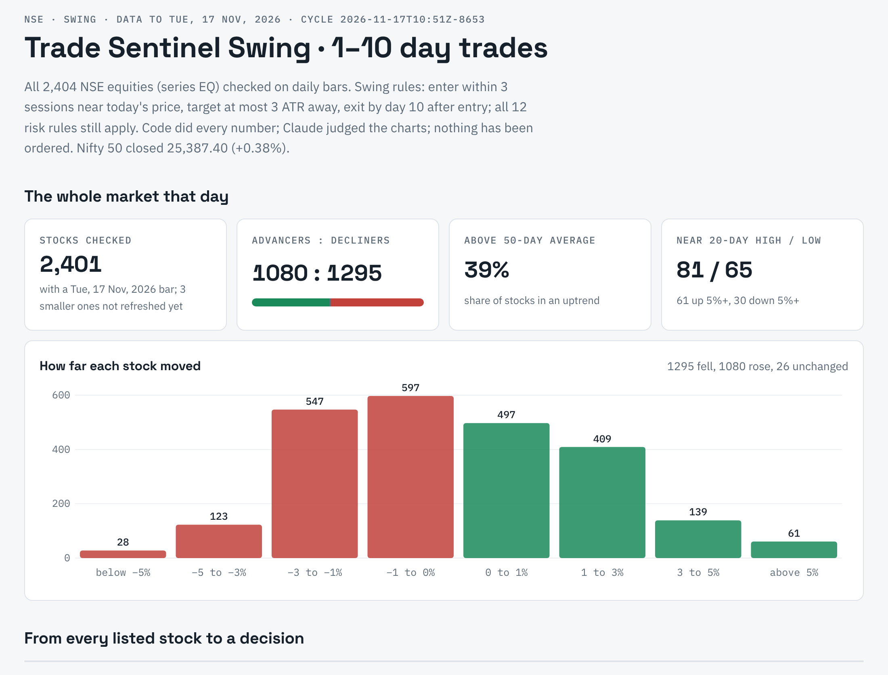
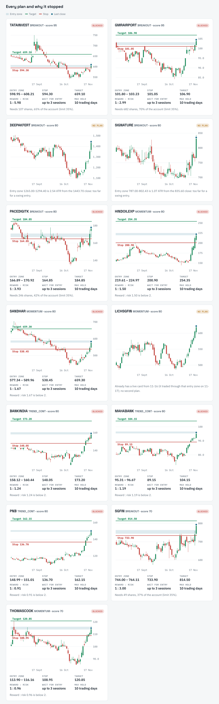
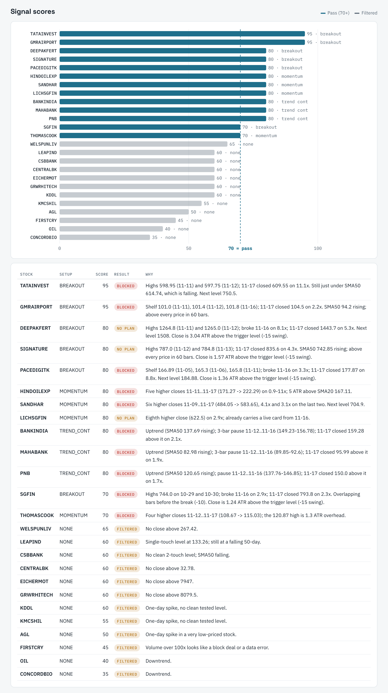

# Trade Sentinel Swing · 2026-11-17

NSE data to **2026-11-17** · cycle `2026-11-17T10:51Z-8653` · Nifty 50 25,387.40 (0.38%)

**2,401 stocks checked** · 1080 advanced, 1295 declined · 39% above their 50-day average · 81 near a 20-day high, 65 near a low

2,404 NSE equities → 971 liquid → 150 shortlisted → 25 scanned → 13 signals passed → 10 planned → **0 approved**

**Swing rules:** enter within 3 sessions, near today's price (within 1.0 ATR); target at most 3.0 ATR away; exit by the close of day 10 after entry if neither stop nor target hits. All 12 risk rules still apply.

## Waiting for your answer

No plan passed every gate in this cycle.

**Blocked:** TATAINVEST needs 107 shares, 65% of the account (limit 35%); GMRAIRPORT needs 682 shares, 70% of the account (limit 35%); PACEDIGITK needs 246 shares, 42% of the account (limit 35%); HINDOILEXP G3_RR 1.5 vs 2.0; SANDHAR G3_RR 1.67 vs 2.0; BANKINDIA G3_RR 1.24 vs 2.0; MAHABANK G3_RR 1.19 vs 2.0; PNB G3_RR 0.91 vs 2.0; SGFIN needs 49 shares, 37% of the account (limit 35%); THOMASCOOK G3_RR 0.96 vs 2.0.

## Market and funnel

## Every plan

## Signal scores

Whole page as one image: [full.png](full.png). Data: [2026-11-17T1051Z-8653.json](2026-11-17T1051Z-8653.json).

_Educational, not investment advice. You place every order yourself._
