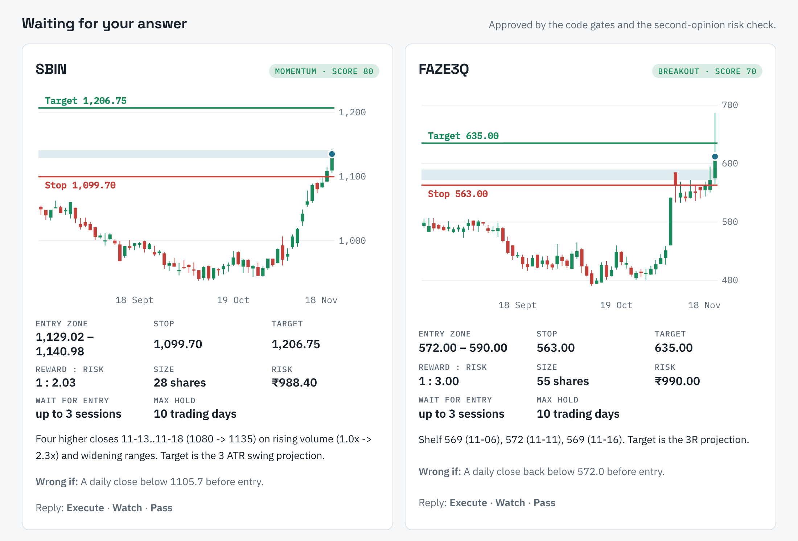
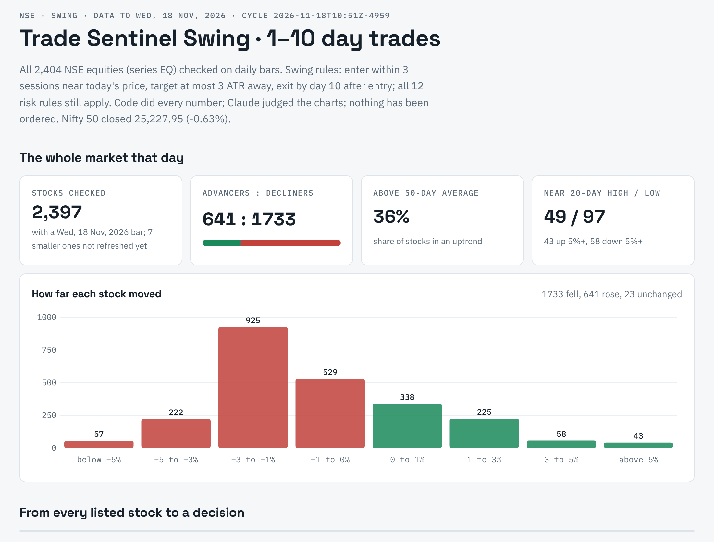
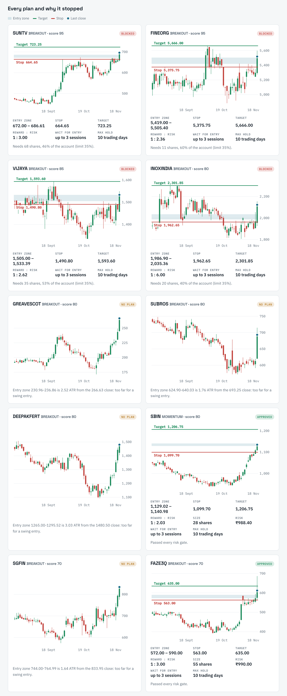
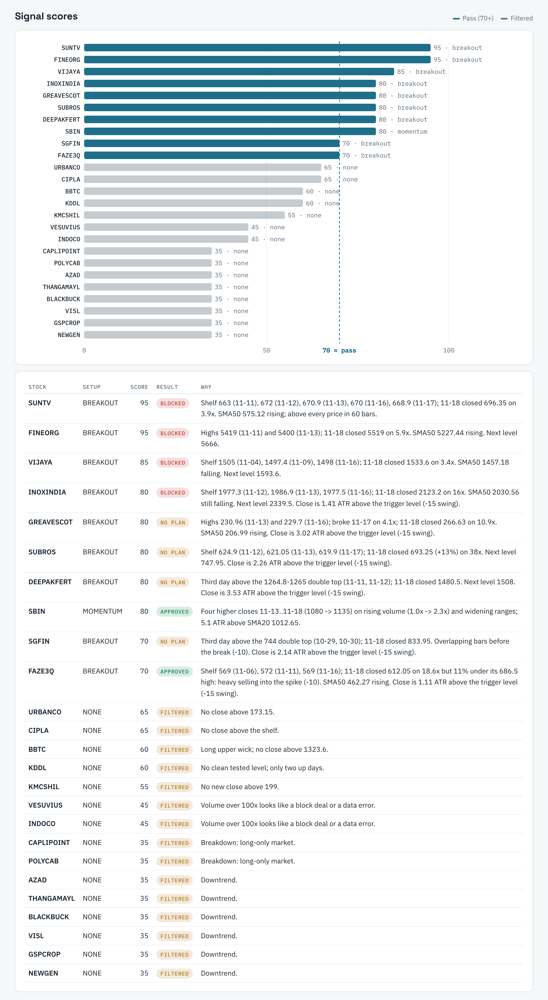

# Trade Sentinel Swing · 2026-11-18

NSE data to **2026-11-18** · cycle `2026-11-18T10:51Z-4959` · Nifty 50 25,227.95 (-0.63%)

**2,397 stocks checked** · 641 advanced, 1733 declined · 36% above their 50-day average · 49 near a 20-day high, 97 near a low

2,404 NSE equities → 972 liquid → 150 shortlisted → 25 scanned → 10 signals passed → 6 planned → **2 approved**

**Swing rules:** enter within 3 sessions, near today's price (within 1.0 ATR); target at most 3.0 ATR away; exit by the close of day 10 after entry if neither stop nor target hits. All 12 risk rules still apply.

## Waiting for your answer

| Stock | Setup | Score | Entry zone | Stop | Target | R:R | Size | Risk |
| --- | --- | ---: | --- | ---: | ---: | ---: | ---: | ---: |
| **SBIN** | MOMENTUM | 80 | 1,129.02 – 1,140.98 | 1,099.70 | 1,206.75 | 2.03 | 28 | ₹988.40 |
| **FAZE3Q** | BREAKOUT | 70 | 572.00 – 590.00 | 563.00 | 635.00 | 3.0 | 55 | ₹990.00 |

**Blocked:** SUNTV needs 68 shares, 46% of the account (limit 35%); FINEORG needs 11 shares, 60% of the account (limit 35%); VIJAYA needs 35 shares, 53% of the account (limit 35%); INOXINDIA needs 20 shares, 40% of the account (limit 35%).

## Market and funnel

## Every plan

## Signal scores

Whole page as one image: [full.png](full.png). Data: [2026-11-18T1051Z-4959.json](2026-11-18T1051Z-4959.json).

_Educational, not investment advice. You place every order yourself._
