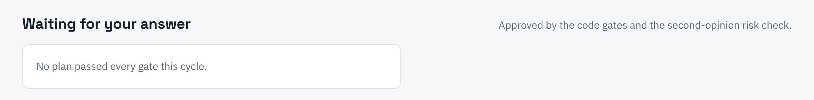
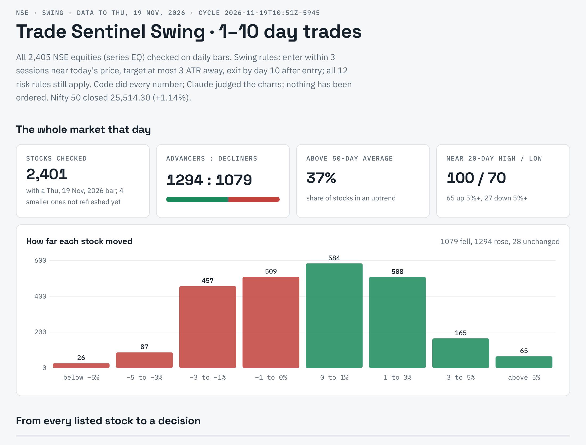
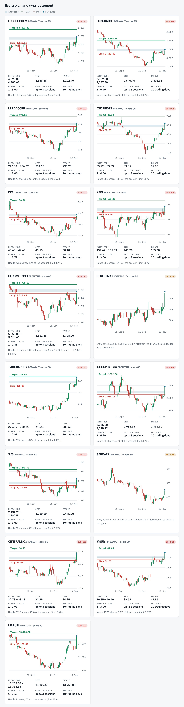
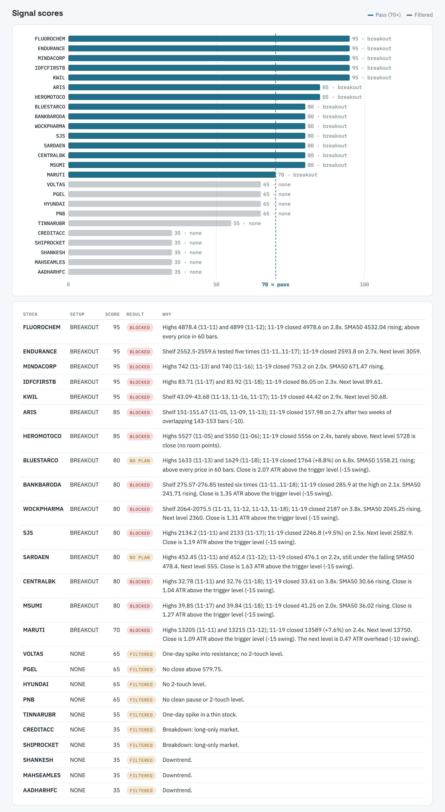

# Trade Sentinel Swing · 2026-11-19

NSE data to **2026-11-19** · cycle `2026-11-19T10:51Z-5945` · Nifty 50 25,514.30 (1.14%)

**2,401 stocks checked** · 1294 advanced, 1079 declined · 37% above their 50-day average · 100 near a 20-day high, 70 near a low

2,405 NSE equities → 964 liquid → 150 shortlisted → 25 scanned → 15 signals passed → 13 planned → **0 approved**

**Swing rules:** enter within 3 sessions, near today's price (within 1.0 ATR); target at most 3.0 ATR away; exit by the close of day 10 after entry if neither stop nor target hits. All 12 risk rules still apply.

## Waiting for your answer

No plan passed every gate in this cycle.

**Blocked:** FLUOROCHEM needs 11 shares, 54% of the account (limit 35%); ENDURANCE needs 26 shares, 67% of the account (limit 35%); MINDACORP needs 70 shares, 52% of the account (limit 35%); IDFCFIRSTB needs 888 shares, 75% of the account (limit 35%); KWIL needs 975 shares, 43% of the account (limit 35%); ARIS needs 256 shares, 39% of the account (limit 35%); HEROMOTOCO needs 13 shares, 73% of the account (limit 35%), G3_RR 1.88 vs 2.0; BANKBARODA needs 295 shares, 82% of the account (limit 35%); WOCKPHARMA needs 23 shares, 48% of the account (limit 35%); SJS needs 21 shares, 45% of the account (limit 35%); CENTRALBK needs 2325 shares, 77% of the account (limit 35%); MSUMI needs 1739 shares, 70% of the account (limit 35%); MARUTI needs 5 shares, 66% of the account (limit 35%).

## Market and funnel

## Every plan

## Signal scores

Whole page as one image: [full.png](full.png). Data: [2026-11-19T1051Z-5945.json](2026-11-19T1051Z-5945.json).

_Educational, not investment advice. You place every order yourself._
