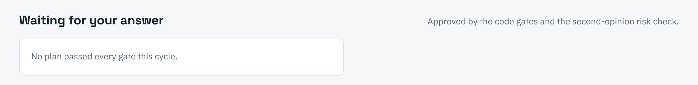
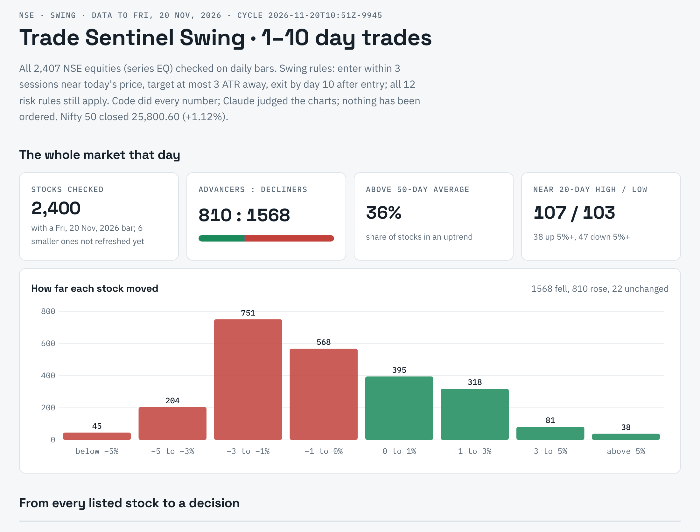
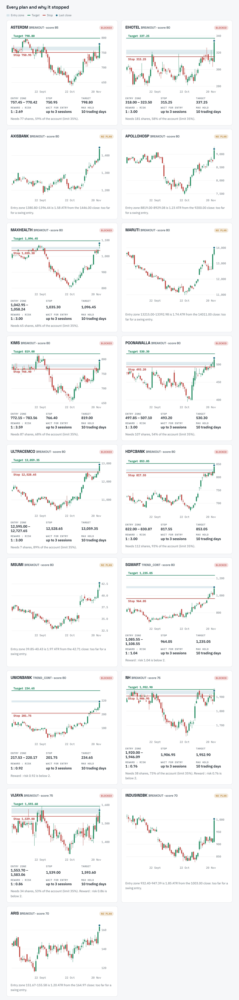
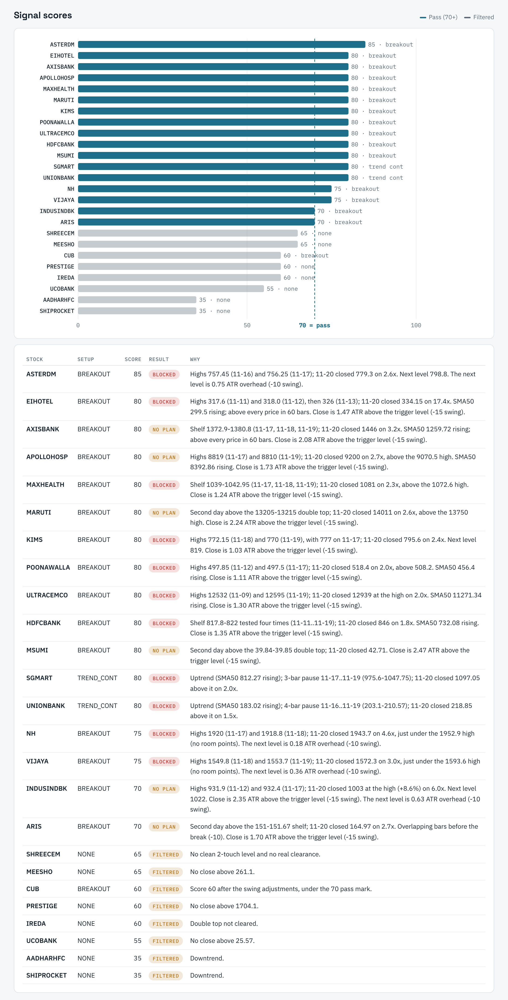

# Trade Sentinel Swing · 2026-11-20

NSE data to **2026-11-20** · cycle `2026-11-20T10:51Z-9945` · Nifty 50 25,800.60 (1.12%)

**2,400 stocks checked** · 810 advanced, 1568 declined · 36% above their 50-day average · 107 near a 20-day high, 103 near a low

2,407 NSE equities → 968 liquid → 150 shortlisted → 25 scanned → 17 signals passed → 11 planned → **0 approved**

**Swing rules:** enter within 3 sessions, near today's price (within 1.0 ATR); target at most 3.0 ATR away; exit by the close of day 10 after entry if neither stop nor target hits. All 12 risk rules still apply.

## Waiting for your answer

No plan passed every gate in this cycle.

**Blocked:** ASTERDM needs 77 shares, 59% of the account (limit 35%); EIHOTEL needs 181 shares, 58% of the account (limit 35%); MAXHEALTH needs 65 shares, 68% of the account (limit 35%); KIMS needs 87 shares, 68% of the account (limit 35%); POONAWALLA needs 107 shares, 54% of the account (limit 35%); ULTRACEMCO needs 7 shares, 89% of the account (limit 35%); HDFCBANK needs 112 shares, 93% of the account (limit 35%); SGMART G3_RR 1.04 vs 2.0; UNIONBANK G3_RR 0.92 vs 2.0; NH needs 38 shares, 73% of the account (limit 35%), G3_RR 0.76 vs 2.0; VIJAYA needs 34 shares, 53% of the account (limit 35%), G3_RR 0.86 vs 2.0.

## Market and funnel

## Every plan

## Signal scores

Whole page as one image: [full.png](full.png). Data: [2026-11-20T1051Z-9945.json](2026-11-20T1051Z-9945.json).

_Educational, not investment advice. You place every order yourself._
