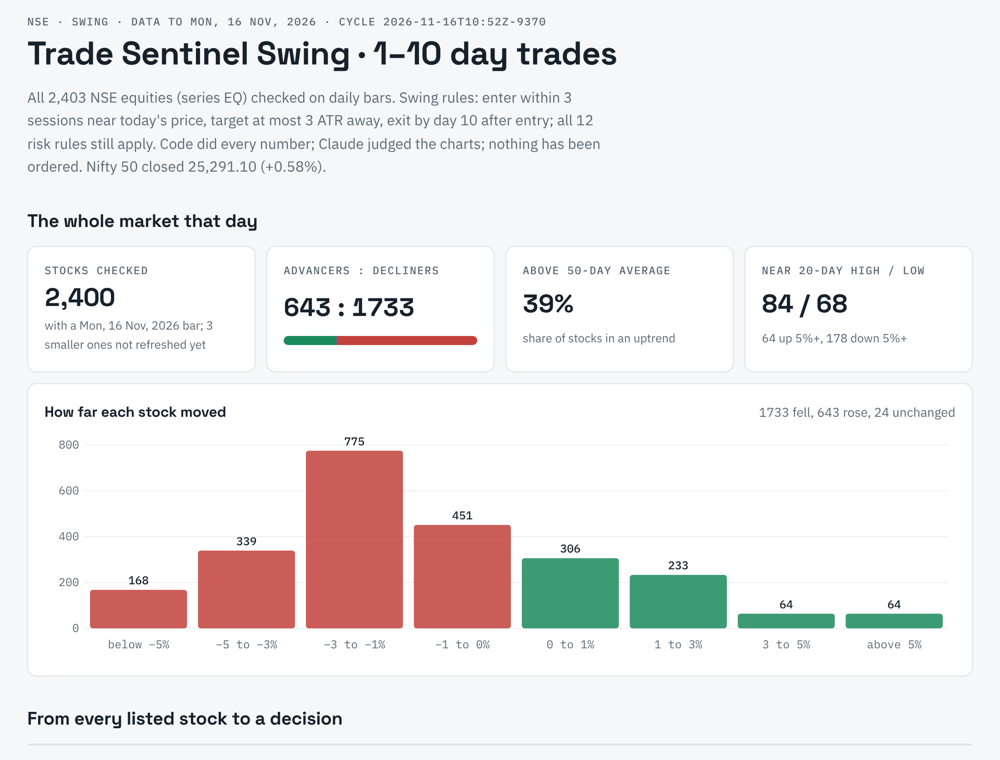

# Trade Sentinel Swing · latest run (2026-11-16)

NSE data to **2026-11-16** · cycle `2026-11-16T10:52Z-9370` · Nifty 50 25,291.10 (0.58%)

**2,400 stocks checked** · 643 advanced, 1733 declined · 39% above their 50-day average · 84 near a 20-day high, 68 near a low

2,403 NSE equities → 974 liquid → 150 shortlisted → 25 scanned → 13 signals passed → 8 planned → **0 approved**

**Swing rules:** enter within 3 sessions, near today's price (within 1.0 ATR); target at most 3.0 ATR away; exit by the close of day 10 after entry if neither stop nor target hits. All 12 risk rules still apply.

Older runs: open a dated folder above.

## Waiting for your answer

No plan passed every gate in this cycle.

**Blocked:** KPRMILL needs 48 shares, 58% of the account (limit 35%); KIMS needs 91 shares, 68% of the account (limit 35%); ASAHIINDIA needs 55 shares, 62% of the account (limit 35%); INDRAMEDCO needs 163 shares, 56% of the account (limit 35%); STYLEBAAZA G3_RR 1.27 vs 2.0; ITC G3_RR 1.26 vs 2.0; LICHSGFIN G3_RR 1.99 vs 2.0; HINDOILEXP G3_RR 1.05 vs 2.0.

## Market and funnel

## Every plan

## Signal scores

Whole page as one image: [full.png](2026-11-16/full.png). Data: [2026-11-16T1052Z-9370.json](2026-11-16/2026-11-16T1052Z-9370.json).

_Educational, not investment advice. You place every order yourself._
