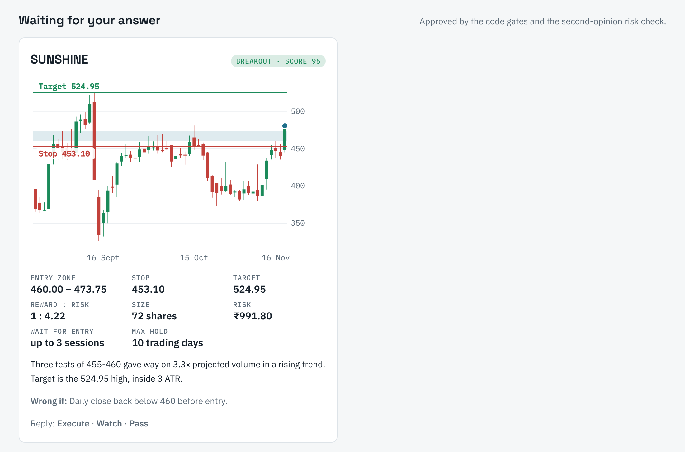
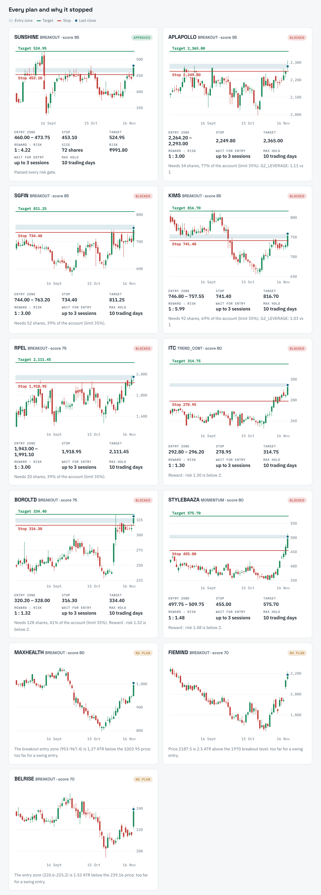
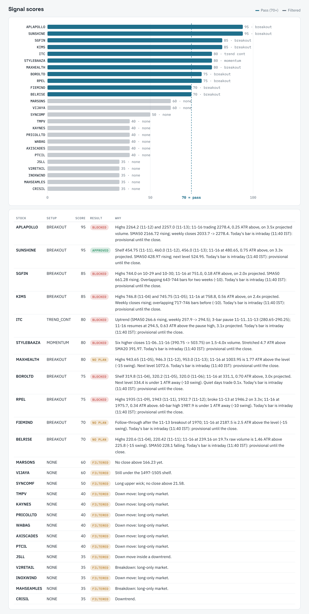

# Trade Sentinel Swing · latest run (2026-11-16)

NSE data to **2026-11-16** · cycle `2026-11-16T06:09Z-2310` · Nifty 50 25,229.85 (0.34%)

**992 stocks checked** · 249 advanced, 737 declined · 49% above their 50-day average · 41 near a 20-day high, 29 near a low

2,391 NSE equities → 944 liquid → 150 shortlisted → 25 scanned → 11 signals passed → 8 planned → **1 approved**

**Swing rules:** enter within 3 sessions, near today's price (within 1.0 ATR); target at most 3.0 ATR away; exit by the close of day 10 after entry if neither stop nor target hits. All 12 risk rules still apply.

Older runs: open a dated folder above.

## Waiting for your answer

| Stock | Setup | Score | Entry zone | Stop | Target | R:R | Size | Risk |
| --- | --- | ---: | --- | ---: | ---: | ---: | ---: | ---: |
| **SUNSHINE** | BREAKOUT | 95 | 460.00 – 473.75 | 453.10 | 524.95 | 4.22 | 72 | ₹991.80 |

**Blocked:** APLAPOLLO needs 34 shares, 77% of the account (limit 35%), G2_LEVERAGE 1.11 vs 1.0; SGFIN needs 52 shares, 39% of the account (limit 35%); KIMS needs 92 shares, 69% of the account (limit 35%), G2_LEVERAGE 1.03 vs 1.0; RPEL needs 20 shares, 39% of the account (limit 35%); ITC G3_RR 1.3 vs 2.0; BOROLTD needs 128 shares, 41% of the account (limit 35%), G3_RR 1.32 vs 2.0; STYLEBAAZA G3_RR 1.48 vs 2.0.

## Market and funnel

## Every plan

## Signal scores

Whole page as one image: [full.png](2026-11-16/full.png). Data: [2026-11-16T0609Z-2310.json](2026-11-16/2026-11-16T0609Z-2310.json).

_Educational, not investment advice. You place every order yourself._
